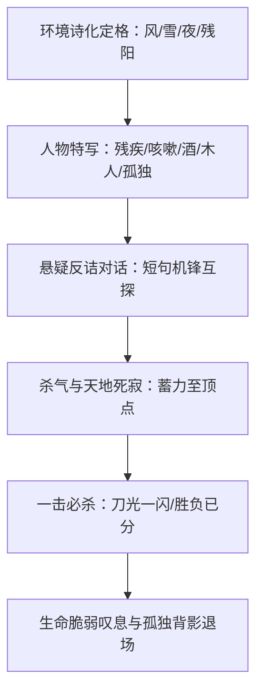

# 古龙 · L2 篇章骨架与叙事结构模型 (Structure Patterns)

> [!NOTE]
> 提炼自古龙全系代表作（《多情剑客无情剑》《天涯明月刀》《陆小凤传奇》《三少爷的剑》）的核心篇章结构。
> 特征：**“悬念诗化开篇”、“氛围声光压制”、“胜负一瞬决杀”与“浪子残阳收尾”**。

---

## 模板一：巅峰对决与悬念刺杀篇章模型

### 1. 开篇环境诗化定格 (开篇 20% 篇幅)
- **极短句对仗与意象并置**：“冷风如刀。残阳如血。长街寂静如死。”
- **无主语或极简主谓**：用名词与静态词构成强烈的电影空镜头。

### 2. 人物特写与反差缺陷 (中段 30% 篇幅)
- **绝不写完美伟人**：主角往往带着生理或心理的深刻缺陷（李寻欢的咳嗽、傅红雪的瘸腿、花满楼的失明、楚留香的鼻窦炎）。
- **通过器物或动作塑造神韵**：雕刻木人、抚摸刀柄、倒酒、嗅花。

### 3. 短句机锋与心理博弈 (中后段 30% 篇幅)
- **快节奏一问一答**：
  > “你来了？”  
  > “我来了。”  
  > “你本不该来的。”  
  > “但我已经来了。”
- **杀气无形蔓延**：在拔刀前，通过空气温度下降、烛火熄灭、风声停滞表现不可逆转的杀意。

### 4. 胜负一瞬与悲悯收束 (结尾 20% 篇幅)
- **绝不描写上百回合打斗**：只有一刀、一剑。“刀光一闪，胜负已分。”
- **直面死亡的尊严与虚无**：死者并非纯粹的反派脸谱，而是倒在追求剑道或贪婪执念中的可悲灵魂；胜者拖着孤独的影子步入风雨长街。
