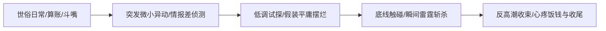

# 冷钻 · L2 篇章骨架与叙事结构模型 (Structure Patterns)

> [!NOTE]
> 基于《赫氏门徒》全书 274 万字提炼的经典篇章叙事结构。冷钻的核心结构特征在于**“反崇高起笔”、“多方信息差纠缠”与“反高潮退场”**。

---

## 模板一：日常生活流转折危机模型 (7:3 危机日常配比)

### 1. 开篇 Hook (开篇 15% 篇幅)
- **拒绝宏大叙事起手**：从极为微小、接地气的世俗琐事切入（如：牛排几成熟、欠黑道多少银鲁克、房东催租、给宠物喂食）。
- **第一人称冷幽默旁白**：以主角充满吐槽欲的内心独白（“天哪”、“我敢打赌这老头子又在坑我”）确立轻快基调。

### 2. 冲突升温与信息差铺陈 (中段 50% 篇幅)
- **多方势力交叉介入**：绝非简单的两方单挑，通常引入第三方、元老院暗探、杀手公会或地方驻军。
- **双重身份认知隔离**：主角维持“冷羽态”（平庸、怕死、胆小），让对手和围观者产生巨大的轻敌错觉，制造极致的情绪蓄水池。

### 3. 高潮蓄势与微能耗斩杀 (后段 25% 篇幅)
- **触碰底线**：当对手威胁到同伴、女人或师门尊严时，气场瞬间切换为“龙羽态”。
- **工科级招式解构**：不搞冗长炫目光效，通过微观晶路共振、重力力矩干涉或落羽剑意，在 1~3 招内完成物理性降维打击。

### 4. 反高潮收束与意境留白 (结尾 10% 篇幅)
- **绝不享受掌声**：斩杀敌人后迅速收剑/戴上面具离开，留下一地目瞪口呆的围观者。
- **冷幽默与诗意双轨收尾**：一边嘴上抱怨“今晚的牛排又泡汤了”，一边在夜风中留下孤独清冷的背影与落羽微光。

---

## 模板二：多方地缘政治与智斗博弈模型

1. **利益盘点**：开局罗列各方势力在晶石资源、军队调动或元老院席位上的硬性诉求。
2. **借力打力**：主角绝不单打独斗，利用敌方内部派系矛盾，释放假情报诱敌深入。
3. **底线捍卫**：在复杂的利益妥协中，始终守住最核心的人性温度与兄弟同袍之约。
